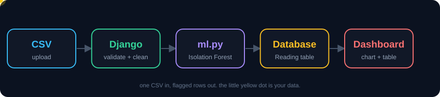
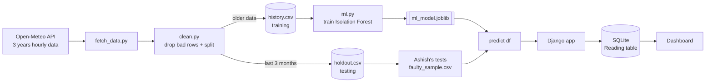
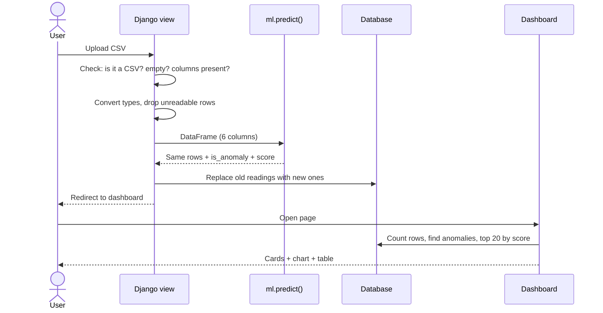
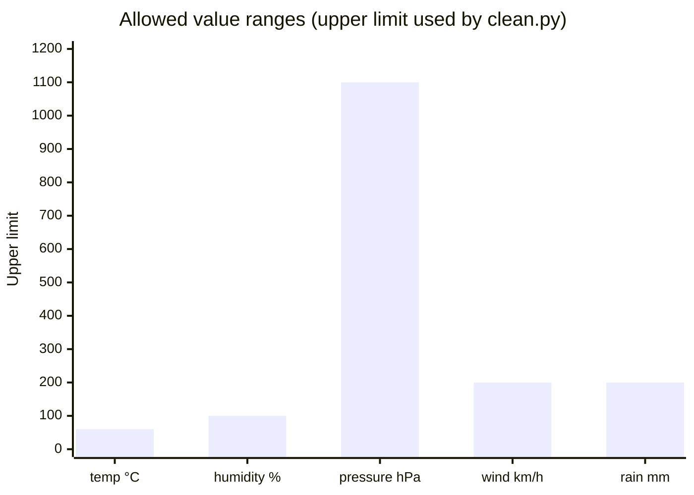
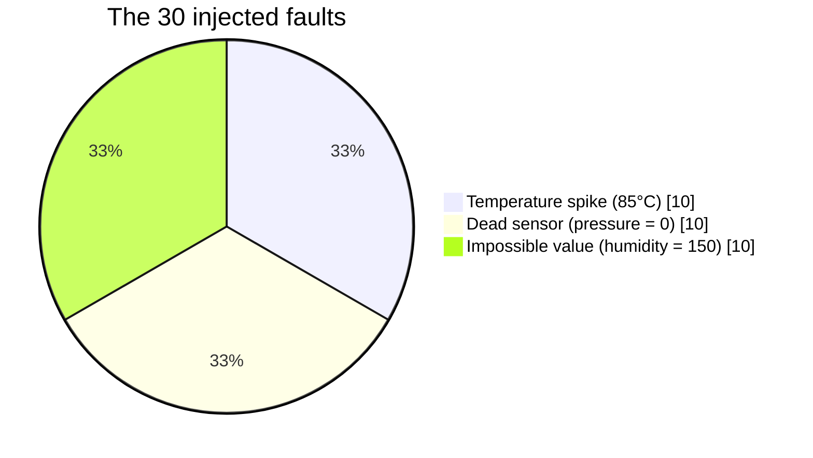
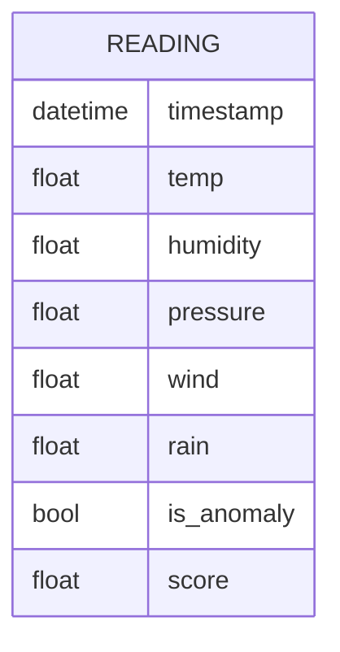

<div align="center">


<br/>


**Upload a CSV of weather sensor readings. Get back every reading that looks wrong, with a chart and a score for each one.**

[Overview](#-overview) · [How it works](#-how-it-works) · [The model](#-the-model) · [Evaluation](#-evaluation) · [Web app](#-the-web-app) · [Run it](#-getting-started) · [Team](#-team)

</div>

---

## 🌦️ Overview

Weather sensors break. They get stuck, they spike, they report a humidity of 150%. If you're collecting thousands of hourly readings, nobody is going to spot those by eye.

This project does it automatically:

1. Trains an **Isolation Forest** on about 3 years of clean historical weather data.
2. Wraps it in a single `predict()` function that any app can call.
3. Plugs that into a **Django** site where you upload a CSV and see the flagged rows on a dashboard.
4. Tests the model against a simple **z-score baseline** on data with deliberately injected faults, so we know whether the ML is actually pulling its weight.

<div align="center">

<sub>Illustrative demo data. Your real chart appears on the dashboard after you upload a file.</sub>
</div>

---

## ⚙️ How it works

<div align="center">

</div>



### What happens when you upload a file



---

## 🧠 The model

We use **Isolation Forest**. The idea is simple and kind of clever: instead of learning what normal looks like and measuring distance from it, it just tries to *isolate* each point with random cuts. Weird points get isolated fast. Normal points take many cuts.

<div align="center">

</div>

**Why this model for this problem**

| Reason | What it means here |
|---|---|
| Looks at all sensors together | A row can be flagged because of an odd *combination* (e.g. hot but very high humidity and zero pressure) |
| No hand-set thresholds | We don't have to decide "above 50°C is bad" for every column |
| Fast | Trains in seconds on ~25,000 rows |
| Gives a score | Not just yes/no, so the dashboard can rank the worst rows first |

**Settings:** 200 trees, features scaled with `StandardScaler`, `contamination = 0.02`. That last one tells the model to expect about 2% of rows to be abnormal. So roughly 2% of normal data **will** get flagged. That's by design, not a bug.

### The `predict()` contract

This never changes, so all three parts of the project can be built at the same time.

| | Columns |
|---|---|
| **Input** | `timestamp`, `temp`, `humidity`, `pressure`, `wind`, `rain` |
| **Output** | everything above, plus `is_anomaly` (True/False) and `score` (higher = more abnormal) |

---

## 📊 Data

| | |
|---|---|
| **Source** | [Open-Meteo Historical Weather API](https://open-meteo.com/) (free, no key) |
| **Range** | 2023-01-01 to 2025-12-31, hourly |
| **Size** | about 26,000 rows, 6 columns |
| **Cleaning** | drop missing values, drop duplicate timestamps, remove impossible values |
| **Split** | last 3 months → `holdout.csv` (testing). Everything earlier → `history.csv` (training) |

Splitting by date and not randomly keeps test data fully separate from training data, so the evaluation is honest.

**Sanity ranges used when cleaning**



---

## 🧪 Evaluation

We don't just trust the model, we test it. Ashish takes 300 rows of holdout data and breaks 30 of them on purpose.



Two methods go head to head:

| | Z-score baseline | Isolation Forest |
|---|---|---|
| **Idea** | Flag any value more than 3 standard deviations from the training mean | Learn normal from all sensors and flag rows that are easy to isolate |
| **Thresholds** | Fixed, per column | Learned |
| **Sees combinations** | No, one column at a time | Yes |

### Results

> Fill this in from `ml/data/results.csv` after running `evaluate.py`. Report whatever comes out, honestly.

| Method | Faults caught (of 30) | False alarms (of 270 normal rows) |
|---|---|---|
| Z-score (>3) | _?_ | _?_ |
| Isolation Forest | _?_ | _?_ |

Things to expect: Isolation Forest will flag around 5 or 6 normal rows because of the 2% contamination setting. If both methods catch all 30, that's fine, just say so. The point in that case is that Isolation Forest got there without any hand-picked thresholds.

Charts generated by the evaluation script land in `ml/data/`: `bar.png` (faults caught per method) and `line.png` (temperature with flagged points in red).

---

## 🖥️ The web app

**Upload page.** Pick a CSV and submit. Friendly error messages for non-CSV files, empty files, missing columns, or files with no usable rows left after cleaning.

**Dashboard.** Three parts:

| Part | What it shows |
|---|---|
| **Count cards** | Total readings, anomalies found, anomaly percentage |
| **Line chart** | Temperature over time (Chart.js). Flagged rows are drawn as bigger red dots |
| **Top 20 table** | The highest-scoring anomalies with *all* columns, so you can see why each row got flagged |

Each upload replaces the previous one, which keeps the demo simple.

### Database



### Try these files

| File | What you should see |
|---|---|
| `sample.csv` | Mostly normal data, maybe a few red points |
| `faulty_sample.csv` | About 30 red points (the injected faults) plus a few extras |
| a `.txt` file, an empty CSV, a CSV missing `pressure` | A clear error message, not a crash |

---

## 📁 Project structure

```
weather-anomaly/
├── ml/                        # model + testing
│   ├── fetch_data.py          # download data from Open-Meteo
│   ├── clean.py               # clean + split into history / holdout
│   ├── ml.py                  # train + predict()
│   ├── ml_model.joblib        # saved model
│   ├── data/                  # history, holdout, sample, faulty files, results
│   └── scripts/
│       ├── inject_faults.py   # makes faulty_sample.csv + labels
│       └── evaluate.py        # Isolation Forest vs z-score
└── aws_anomaly/               # Django project
    ├── manage.py
    ├── requirements.txt
    └── detector/
        ├── models.py          # Reading table
        ├── views.py           # upload + dashboard
        ├── urls.py
        ├── ml.py              # copy of the model code
        ├── ml_model.joblib    # copy of the saved model
        └── templates/detector/
```

---

## 🚀 Getting started

**1. Clone and set up**

```bash
git clone <your-repo-url>
cd weather-anomaly
python -m venv venv
source venv/bin/activate        # Windows: venv\Scripts\activate
pip install pandas scikit-learn joblib requests matplotlib django
```

> Everyone on the team must use the **same scikit-learn version**. A model saved with one version can warn or break on another. Check yours with `pip show scikit-learn`.

**2. Build the data and model** (always from inside `ml/`)

```bash
cd ml
python fetch_data.py
python clean.py
python ml.py
```

**3. Run the evaluation**

```bash
python scripts/inject_faults.py
python scripts/evaluate.py
```

**4. Start the website**

```bash
cd ../aws_anomaly
python manage.py migrate
python manage.py runserver
```

Open `http://127.0.0.1:8000`, upload `sample.csv`, then `faulty_sample.csv`.

---

## 👥 Team

| Person | Owns | Hands off |
|---|---|---|
| **Kunal** | Data, cleaning, model training, `predict()` | model file + holdout + sample file |
| **Ashish** | Fault injection, z-score baseline, evaluation, charts | `faulty_sample.csv` + results |
| **Sahasra** | Django app, upload page, dashboard | working site + requirements file |

```mermaid
gantt
    title Who does what (rough hours)
    dateFormat  HH:mm
    axisFormat  %H:%M
    section Kunal
    Setup + data + clean     :k1, 00:00, 75m
    Train + sanity check     :k2, after k1, 65m
    Handoff                  :k3, after k2, 15m
    section Ashish
    Wait for model           :crit, a0, 00:00, 155m
    Verify + inject faults   :a1, after a0, 45m
    Evaluate + charts        :a2, after a1, 65m
    section Sahasra
    Setup + DB               :s1, 00:00, 35m
    Upload + dashboard       :s2, after s1, 150m
    Final testing            :s3, after s2, 45m
```



---

## 🛠️ Troubleshooting

| Problem | Fix |
|---|---|
| `FileNotFoundError` for a data file | You ran a script from the wrong folder. Run ML scripts from inside `ml/` |
| Warning about scikit-learn versions when loading the model | Install the same version Kunal used, or retrain with `python ml.py` |
| Missing columns error on upload | CSV needs exactly: `timestamp, temp, humidity, pressure, wind, rain` |
| Timezone warnings in Django | Make sure `USE_TZ = False` in `settings.py` |
| Dashboard chart is empty | Upload a file first. The dashboard shows whatever the last upload saved |

---

## 🔮 Ideas for later

- Per-sensor anomaly explanations (which column pushed the score up)
- Keep upload history instead of replacing it
- Live data feed instead of CSV uploads
- Tune `contamination` from the dashboard
- Try other detectors (One-Class SVM, autoencoder) and add them to the comparison

---

<div align="center">

Built by Kunal, Ashish and Sahasra.

If a sensor says it's 85°C in Delhi in January, we'll notice.

</div>
